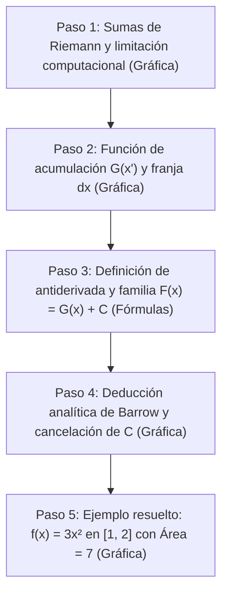

# Fundamentación Matemática y Guion Técnico: Teorema Fundamental del Cálculo (Parte II)

**Asignatura:** MAT1188 – Cálculo Intermedio  
**Eje 9 / Grupo 9:** Calcular una integral mediante antiderivadas  
**Pregunta Central:** *¿Por qué una integral definida puede calcularse como $F(b) - F(a)$?*

---

## Pregunta Central y Fundamento Matemático

El cálculo de áreas mediante el límite formal de sumas de Riemann requiere particiones infinitas y sumatorias algebraicas de alta complejidad. El Teorema Fundamental del Cálculo (TFC) resuelve esto conectando dos conceptos aparentemente desconectados: la acumulación de área y la razón de cambio instantánea (derivada).

- **Condición necesaria:** La función $f(x)$ debe ser continua en el intervalo cerrado $[a, b]$.
- **Respuesta a la pregunta central:** La integral definida acumula área a una tasa instantánea dictada por $f(x)$. Toda función de acumulación $G(x') = \int_a^{x'} f(t)dt$ es una antiderivada particular donde $G(a) = 0$. Cualquier otra antiderivada conocida $F(x)$ difiere de $G(x)$ únicamente por una constante ($F(x) = G(x) + C$). Al evaluar la resta $F(b) - F(a)$, la constante $C$ se anula idénticamente, recuperando el valor exacto de la acumulación total $\int_a^b f(x)dx$.

---

## Distribución de Escenas

---

### Paso 1: Motivación mediante Sumas de Riemann (Con Graficación)
- **Concepto:** La integral definida surge como el límite de sumas de áreas de rectángulos:
  $$\int_a^b f(x)dx = \lim_{n \to \infty} \sum_{i=1}^n f(x_i^*) \Delta x, \quad \text{donde } \Delta x = \frac{b - a}{n}$$
- **Objetivo pedagógico:** Mostrar cómo al refinar la partición ($n = 4 \to 8 \to 32$), el error visual disminuye pero la complejidad analítica crece exponencialmente.
- **Visualización en Manim:**
  - Gráfica de una función continua.
  - Rectángulos de Riemann cambiando dinámicamente de $n=4$ a $n=32$.
  - Muestra del texto explicativo: $\Delta x \to 0$ cuando $n \to \infty$.

---

### Paso 2: Función de Acumulación y TFC 1 (Con Graficación)
- **Concepto:** Se define la función de acumulación con límite superior variable $x'$:
  $$G(x') = \int_a^{x'} f(t) dt \quad \text{con } x' \in [a, b]$$
- **La Franja Diferencial (el "rectangulito de extensión"):**
  - Al desplazar el extremo superior en un pequeño incremento $\Delta x$, el área experimenta una extensión $\Delta G$:
    $$\Delta G \approx f(x') \cdot \Delta x$$
  - Dividiendo por la base $\Delta x$, obtenemos la razón de cambio del área respecto al extremo $x'$:
    $$\frac{\Delta G}{\Delta x} \approx f(x') \implies \frac{dG}{dx'} = f(x')$$
- **Conclusión del TFC 1:** Llegar a $\frac{dG}{dx'} = f(x')$ es llegar directamente a la definición de derivada. La derivada de la acumulación de área es la altura de la curva original. Por consiguiente, la función de acumulación $G(x')$ es, por definición, una **antiderivada** de $f(x)$.
- **Visualización en Manim:**
  - Curva $f(t)$ con área sombreada desde $a$ hasta $x'$.
  - Franja rectangular de ancho $\Delta x$ adyacente a $x'$ resaltada en otro color (el "cuadrado" de extensión).
  - Rótulos sincronizados mostrando la relación $\frac{dG}{dx'} = f(x')$.

---

### Paso 3: Definición de Antiderivada y Familia de Primitivas (Sin Graficación / Fórmulas en Pantalla)
- **Definición:** Una función $F(x)$ se denomina antiderivada de $f(x)$ si cumple:
  $$F'(x) = f(x)$$
- **Familia Infinita de Antiderivadas:**
  - Sabemos que la derivada de cualquier constante es cero:
    $$\frac{d}{dx}(C) = 0$$
  - Por lo tanto, si sumamos una constante $C$ a cualquier antiderivada conocida, obtenemos otra antiderivada válida de la misma función:
    $$(G(x') + C)' = G'(x') + 0 = f(x')$$
  - Esto significa que existe una familia infinita de posibles antiderivadas, todas relacionadas mediante:
    $$F(x') = G(x') + C$$

---

### Paso 4: Segundo Teorema Fundamental del Cálculo / Regla de Barrow (Con Graficación)
- **Deducción Analítica:**
  1. Relación fundamental:
     $$F(x') = G(x') + C$$
  2. Evaluación en el extremo inicial ($x' = a$):
     $$G(a) = \int_a^a f(t) dt = 0 \implies F(a) = 0 + C \implies C = F(a)$$
  3. Evaluación en el extremo final ($x' = b$):
     $$G(b) = \int_a^b f(t) dt \implies F(b) = G(b) + C$$
  4. Resta de ambos extremos:
     $$F(b) - F(a) = [G(b) + C] - [G(a) + C] = G(b) - G(a)$$
     $$F(b) - F(a) = \int_a^b f(t) dt - 0$$
  5. Identidad final (Regla de Barrow):
     $$\int_a^b f(x) dx = F(b) - F(a)$$
- **Conclusión Clave:** La constante $C$ se cancela en la resta ($C - C = 0$). No importa qué antiderivada se utilice, la diferencia $F(b) - F(a)$ entrega invariablemente el área exacta.
- **Visualización en Manim:**
  - Gráfica a la izquierda con el área total sombreada entre $a$ y $b$.
  - Ecuaciones a la derecha apareciendo progresivamente hasta encerrar la fórmula de Barrow en un recuadro destacado.

---

### Paso 5: Ejemplo Completo y Verificación Numérica (Con Graficación)

Para evitar fracciones complejas en pantalla y mantener una escala visual limpia en Manim:

$$\mathbf{f(x) = 3x^2} \quad \text{en el intervalo} \quad [1, 2]$$

#### 1. Datos del Ejemplo
- Función integrando: $f(x) = 3x^2$ (continua y no negativa en $[1, 2]$).
- Límites: $a = 1$, $b = 2$.
- Expresión a calcular: $\int_1^2 3x^2 dx$.

#### 2. Cálculo Analítico
- Antiderivada elemental:
  $$F(x) = x^3$$
- Aplicación de la Regla de Barrow:
  $$\int_1^2 3x^2 dx = \Big[ x^3 \Big]_1^2 = F(2) - F(1)$$
  $$F(2) = 2^3 = 8$$
  $$F(1) = 1^3 = 1$$
  $$\int_1^2 3x^2 dx = 8 - 1 = \mathbf{7}$$

#### 3. Verificación de Invarianza ante $C$
Si se elige otra antiderivada con constante arbitraria, por ejemplo $F_2(x) = x^3 + 5$:
$$F_2(2) - F_2(1) = (2^3 + 5) - (1^3 + 5) = 13 - 6 = \mathbf{7}$$
Se comprueba numéricamente la cancelación de la constante.

- **Visualización en Manim:**
  - Curva $f(x) = 3x^2$ trazada en los ejes.
  - Sombreado del área bajo la curva desde $x=1$ hasta $x=2$.
  - Rótulo animado indicando: $\text{Área } = 7$.

---

## Especificaciones Técnicas para Manim

| Escena | Clase Manim | Elementos Visuales | Parámetros Ejes / Gráficos |
| :--- | :--- | :--- | :--- |
| **Paso 1** | `Scene1RiemannMotivation` | Curva continua + rectángulos de Riemann variables | `x_range: [0, 3.5, 1]`, `y_range: [0, 14, 2]`. $n \in \{4, 8, 32\}$. Color: `BLUE`. |
| **Paso 2** | `Scene2AccumulationTFC1` | Área dinámica hasta $x'$ + franja rectangular $dx$ | `ValueTracker(1.5)` para $x'$. Curva: `ORANGE`. Franja: `YELLOW`. |
| **Paso 3** | `Scene3AntiderivativeTheory` | Tipografía matemática (`MathTex`) | Sin ejes. Fórmulas ordenadas verticalmente con `SurroundingRectangle`. |
| **Paso 4** | `Scene4BarrowDeduction` | Gráfica estática $[a, b]$ a la izquierda + deducción a la derecha | Gráfica en `to_edge(LEFT)`. Texto paso a paso en `to_edge(RIGHT)`. Recuadro: `YELLOW`. |
| **Paso 5** | `Scene5ExampleCalculation` | Curva $3x^2$, área sombreada $= 7$ y desarrollo numérico | Ejes: `x_range: [0, 2.5, 1]`, `y_range: [0, 14, 2]`. Área: `GREEN` (`opacity=0.6`). |

---
